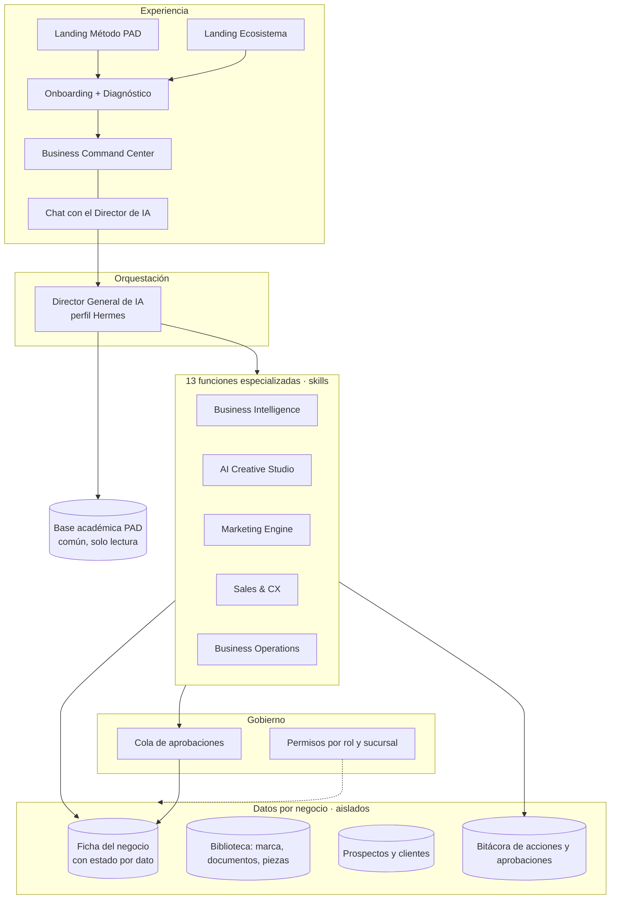
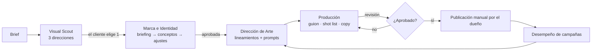

# Detailbox AI Ecosystem · Diagnóstico y Arquitectura Maestra

- **Versión:** 0.1 (borrador para aprobación)
- **Fecha:** 13 de noviembre de 2026
- **Responde a:** `curso/masterprompt.md` §17 («Tu primera tarea»)
- **Fuentes:** `curso/masterprompt.md`, `curso/skill.md`, `curso/Detailbox_Academy_Base_de_Conocimiento_Metodo_PAD.md`, `docs/RESEARCH.md` (corte 11-ago-2026)
- **Estado:** propuesta. Nada de lo descrito está construido salvo lo marcado como **hecho** en el §10.

> Convención de evidencia: **[Fuente]** = está en los documentos del cliente. **[Propuesta]** = recomendación de este documento. **[Estimación]** = cifra aproximada que debe validarse. **[Pendiente]** = dato que solo Detailbox puede confirmar.

---

## 1. Interpretación de la visión

Detailbox Academy hoy forma técnicos (detailing, PPF, antiasalto, car wrap) **[Fuente: RESEARCH]**. La visión es acompañar al egresado **después** del curso técnico. Primero le enseña a operar como empresa con el **Método PAD** (Prepara → Apunta → Dispara). Después le entrega un **sistema operativo de negocio con IA** que hace el trabajo de consultor, agencia, productora, equipo comercial y analista, a escala de un taller pequeño **[Fuente: masterprompt §1–2]**.

En una frase: **el curso enseña el método y el ecosistema lo ejecuta con el alumno**. Esa relación es la ventaja competitiva. El alumno no compra «chatbots»: compra la continuidad del método que aprendió en el aula.

Tres consecuencias de diseño:

1. **El Método PAD es la columna vertebral del producto**, no un adorno: los módulos, los agentes y los niveles se ordenan en P, A y D **[Fuente: masterprompt §3]**.
2. **La ficha del negocio es el centro de todo.** Cada agente lee y propone sobre la misma fuente autorizada, y cada dato lleva un estado: confirmado, estimado, pendiente o desactualizado **[Fuente: Base PAD §11]**.
3. **La IA propone y el dueño aprueba.** Ningún agente publica, cobra, cambia precios ni habla con terceros sin autorización **[Fuente: masterprompt §13]**.

## 2. Diagnóstico de viabilidad

| Dimensión | Lectura | Veredicto |
|---|---|---|
| **Comercial** | Audiencia propia: 21,150 «Me gusta» en Facebook y 1,415 seguidores en Instagram **[Fuente: RESEARCH]**. Sus alumnos son el canal natural de adopción. La disposición a pagar una suscripción **no está validada**. | Viable si se valida con un piloto antes de construir los niveles altos |
| **Técnica: PAD Core** | Diagnóstico, paquetes, contenido y guiones de venta son tareas de lenguaje sobre datos que da el propio usuario. Softvibes ya opera agentes Hermes conectados a una web (Cisne Negro, Grupo Zamna). | **Viable** a corto plazo |
| **Técnica: integraciones** | WhatsApp Business Platform, Meta Ads, Google Business Profile y los bancos de imágenes requieren cuentas verificadas, revisión de app o licencias **por negocio**. No se pueden prometer como «conectados» desde el día uno. | Viable por fases y con trámite de cada negocio |
| **Técnica: franquicias** | Requiere varias organizaciones, sucursales, roles y datos aislados. Si se modela desde el inicio, añadirlo después es barato; si no, obliga a rehacer la base. | Diseñar ya, construir después |
| **Operativa** | Necesita a alguien en Detailbox que sea dueño del contenido académico, apruebe criterios y dé soporte a alumnos no técnicos. | **Bloqueante** si no se asigna (D10) |
| **Legal** | Hay datos personales de clientes y prospectos de cada taller (LFPDPPP vigente: aviso de privacidad, finalidades, transferencias). Además, derechos de imagen y licencias de recursos visuales. | Manejable con aviso de privacidad, contratos y reglas del §13 |
| **Económica** | El costo variable principal es el consumo del modelo por negocio. Hay que controlarlo con límites por nivel y cálculos sin IA cuando se pueda. | Viable con límites; precio de niveles **[Pendiente]** |

**Conclusión.** Es viable si se construye en fases y se valida con alumnos reales antes de crecer. Lo que no es viable es construir los 18 agentes y los 18 módulos a la vez. El propio masterprompt lo prohíbe (§14, §16).

## 3. Arquitectura general **[Propuesta]**

**Seis capas:**

1. **Experiencia:** landings, onboarding, dashboard y chat. Pensada para un emprendedor no técnico (§12).
2. **Orquestación:** un Director de IA que entiende el objetivo, detecta los datos faltantes, elige la función y controla la calidad.
3. **Funciones:** 13 capacidades especializadas, implementadas como *skills* del orquestador y no como 13 servidores (ver §7).
4. **Datos:** una ficha por negocio con estado por dato, biblioteca, CRM y bitácora. Aislados por negocio y sucursal.
5. **Conocimiento académico:** la Base PAD, común a todos, de solo lectura y versionada por Detailbox.
6. **Gobierno:** cola de aprobaciones, permisos por rol y registro de cada acción automatizada (§13).

## 4. Mapa de los cinco microecosistemas

| Microecosistema | Propósito | Funciones | Etapa PAD | Nivel mínimo |
|---|---|---|---|---|
| **01 Business Intelligence** (se propone renombrarlo **Business Strategy** para no chocar con el agente 12) | Analizar el negocio y construir la oferta | Diagnóstico Empresarial · Paquetes y Precios · Inteligencia de Mercado | P | Starter (Mercado: BI) |
| **02 AI Creative Studio** | Casa productora: marca, dirección visual y piezas | Visual Intelligence Scout · Marca e Identidad · Dirección de Arte · Producción de Contenido | P → A | Growth |
| **03 Marketing Engine** | Estrategia, calendario y pauta | Estrategia de Contenido · Medios y Publicidad | A | Starter (Medios: Growth) |
| **04 Sales & Customer Experience** | Convertir y retener | Ventas y Cotización · Asistente WhatsApp · CRM y Experiencia | D | Starter (WhatsApp y CRM: Growth) |
| **05 Business Operations** | Medir, administrar y escalar | Inteligencia de Negocio y Desempeño (después: finanzas, inventario, RR. HH., calidad y franquicias) | D → escala | Business Intelligence |

**Correspondencia con los productos comerciales (§8):**

| Complemento a la carta | Funciones que agrupa |
|---|---|
| Business Builder | Diagnóstico, Paquetes y Precios, Inteligencia de Mercado |
| Content Factory | Visual Scout, Marca, Dirección de Arte, Estrategia y Producción de Contenido |
| Traffic Generator | Medios y Publicidad, Desempeño de campañas |
| Sales Machine | Ventas y Cotización, Asistente WhatsApp |
| Customer Loyalty | CRM y Experiencia |

## 5. Los 18 agentes, consolidados en 13 funciones

El masterprompt define 18 agentes y pide «evitar duplicar funciones» (§16). Cinco pares o tríos hacen lo mismo con nombres distintos. **[Propuesta]:** consolidarlos, conservar los nombres originales como alias y no perder ninguna responsabilidad.

| # | Función | Agentes del masterprompt | Tipo (§11) | Lee de la ficha | Produce | Aprobación | Nivel |
|---|---|---|---|---|---|---|---|
| 0 | **Director General de IA** | Master Orchestrator (§5) | Orquestador | Toda la ficha autorizada | Plan, asignación, control de calidad | — | Todos |
| 1 | Diagnóstico Empresarial | 1 | Flujo guiado + asistente | Identidad, operación | Diagnóstico, etapa, prioridades | Dueño confirma | Starter |
| 2 | Paquetes y Precios | 2 | Asistente + **calculadora determinística** | Servicios, costos | Catálogo, paquetes, matriz de márgenes | Obligatoria (precios) | Starter |
| 3 | Inteligencia de Mercado | 4 | Asistente con búsqueda y fuentes | Zona, segmento | Mapa de competencia **con fuentes** | Revisión | BI |
| 4 | Marca e Identidad | 3 Brand Builder + 14 Brand Identity Architect | Flujo con puertas de aprobación | Identidad, propuesta de valor | Personalidad, conceptos, manual | En cada puerta | Growth |
| 5 | Visual Intelligence Scout | 13 | Asistente de investigación | Marca, segmento | 3 direcciones creativas (moodboard de **referencias**) | Elegir 1 de 3 | Growth |
| 6 | Dirección de Arte | 7 Creative Director + 15 Art Director | Asistente | Marca aprobada | Lineamientos, prompts visuales, criterios de calidad | Revisión | Growth |
| 7 | Estrategia de Contenido | 5 Content Strategist | Asistente | Cliente ideal, oferta | Pilares, calendario editorial | Revisión | Starter |
| 8 | Producción de Contenido | 6 Reel Producer + 16 Content Producer | Flujo (brief → guion → toma) | Calendario, dirección de arte | Guiones, shot lists, copies, CTA | Antes de publicar | Growth |
| 9 | Medios y Publicidad | 8 Media Buyer + 17 Advertising Mix | Asistente (no ejecuta pauta) | Objetivos, presupuesto | Mezcla de canales, presupuesto, audiencias | Obligatoria (gasto) | Growth |
| 10 | Ventas y Cotización | 9 Sales Closer | Asistente para el dueño | Paquetes aprobados | Guiones, cotizaciones, guía de objeciones | Cotización: dueño | Starter |
| 11 | Asistente WhatsApp | 10 | **Automatizado**, por fases | Paquetes, políticas, FAQ aprobadas | Respuestas a prospectos | Fase 1: el dueño envía cada respuesta | Growth |
| 12 | CRM y Experiencia | 11 | Flujo + datos | Prospectos, servicios | Pipeline, seguimientos, postventa | Mensajes salientes | Growth |
| 13 | Inteligencia de Negocio y Desempeño | 12 Business Intelligence + 18 Campaign Performance Analyst | **Cálculo determinístico** + narrativa | KPIs, campañas, ventas | Tablero, alertas, lecturas por periodo | — | BI |

**Reglas de diseño de las funciones:**

- Los cálculos (márgenes, CPL, ROAS, conversión, ticket) **los hace código, no el modelo**. El modelo los explica. Así se evita inventar cifras (Base PAD §9, masterprompt §13).
- Solo la función 11 habla con terceros. Por eso es la última en automatizarse y empieza en modo borrador.
- Ninguna función escribe datos «confirmados»: genera **propuestas** que entran a la cola de aprobación.

## 6. Flujo de información entre agentes

**Principio:** las funciones no se hablan directamente. Se comunican a través de la **ficha del negocio**, y el Director de IA coordina. Así se evitan las contradicciones y todo queda en la bitácora.

| Produce → | Lo consume |
|---|---|
| Diagnóstico (1) | Todas: etapa, capacidad, objetivos |
| Paquetes y Precios (2) | Contenido (7, 8), Ventas (10), WhatsApp (11), Desempeño (13) |
| Mercado (3) | Paquetes (2), Marca (4), Medios (9) |
| Scout (5) → Marca (4) | Dirección de Arte (6) |
| Dirección de Arte (6) | Producción (8) |
| Estrategia de Contenido (7) | Producción (8), Medios (9) |
| Medios (9) | Desempeño (13) |
| Ventas (10) / WhatsApp (11) | CRM (12) |
| CRM (12) | Desempeño (13), Ventas (10) |
| Desempeño (13) | Director (0): ajustes al plan del mes siguiente |

**Flujo típico de un alumno nuevo (nivel Starter):**
Onboarding → Diagnóstico (1) → el dueño confirma la ficha → Paquetes (2) → el dueño aprueba los precios → Estrategia de Contenido (7) → Ventas (10) con guiones basados en paquetes aprobados → Plan de 30 días (Base PAD §10) → revisión semanal de KPIs.

## 7. Estructura del Director General de IA

**Ciclo de cada solicitud:**

1. **Entender**: el objetivo y la etapa PAD (P, A o D).
2. **Revisar** la ficha. No vuelve a pedir datos confirmados; solo pregunta lo esencial que falta (Base PAD §16).
3. **Elegir** la función o funciones necesarias, sin ejecutar todo (§5 del masterprompt).
4. **Ejecutar** con herramientas acotadas: leer la ficha, proponer cambios y calcular.
5. **Controlar la calidad** con el estándar de la Base PAD §14 (8 comprobaciones).
6. **Responder** en el formato de 7 partes: objetivo, diagnóstico, hallazgo, recomendación, plan, indicador y validación requerida.
7. **Pedir aprobación** cuando haya precios, publicación, gasto, identidad o mensajes a terceros.
8. **Registrar** en la bitácora qué se propuso, quién lo aprobó y cuándo.

**Implementación [Propuesta]:** un perfil Hermes por entorno (`detailbox-pad`), con una *skill* por función. Las 13 funciones comparten identidad, reglas y memoria del negocio. Es el patrón que ya funciona en Agente Cisne («un agente con herramientas, no una cadena de agentes»). Se separa en un proceso propio solo lo que exige aislamiento: el Asistente WhatsApp que atiende a terceros.

**Memoria:** la memoria empresarial es la ficha y la bitácora en la base de datos, **por negocio**. La memoria interna del modelo no guarda datos de un negocio que puedan filtrarse a otro.

## 8. Casa productora inteligente (AI Creative Studio)

- **Puertas obligatorias:** no hay logotipos sin moodboard aprobado (masterprompt §4.B) ni producción sin dirección de arte aprobada.
- **Licencias:** cada recurso se etiqueta como **referencia de inspiración** (solo enlace) o **activo autorizado** (con licencia registrada). El Scout solo entrega referencias; la licencia la adquiere el negocio.
- **Generación de imágenes y video:** opcional y por nivel. Se evalúan proveedores de API y la ruta ComfyUI que Softvibes ya opera. Las imágenes generadas se marcan como tales y nunca sustituyen fotos reales de trabajos en publicaciones de «antes y después».
- **Bancos de imágenes (Envato, Adobe Stock, Shutterstock, Freepik, Pinterest, Behance):** el acceso por API es limitado, de pago o cerrado según la plataforma. **[Pendiente de verificar una por una]** antes de ofrecer búsqueda integrada. Mientras tanto, el Scout trabaja con enlaces públicos y lo que suba el usuario.

## 9. Diseño conceptual del dashboard (Business Command Center)

Los 18 módulos del masterprompt (§7) se agrupan en 6 áreas para un usuario no técnico:

| Área | Módulos (§7) | Starter | Growth | BI |
|---|---|---|---|---|
| **Inicio** | 1 Resumen ejecutivo · 18 Plan de acción · alertas | ✔ | ✔ | ✔ |
| **Prepara** | 2 Diagnóstico · 3 Estrategia y objetivos · 5 Catálogo · 6 Paquetes y rentabilidad | ✔ (2, 5, 6) | ✔ | ✔ |
| **Marca y creación** | 4 Marca · 7 Casa productora · 8 Calendario de contenidos · 17 Biblioteca | ✔ (8) | ✔ | ✔ |
| **Apunta** | 9 Campañas | — | ✔ | ✔ |
| **Dispara** | 10 Prospectos y CRM · 11 Ventas y cotizaciones · 12 Atención | ✔ (10 básico) | ✔ | ✔ |
| **Control** | 13 Operaciones · 14 Finanzas · 15 Indicadores · 16 Centro de agentes | ✔ (16) | ✔ (15) | ✔ |

**MVP (Starter): 7 pantallas que cubren 8 módulos del §7:** Resumen (1) · Diagnóstico (2) · Servicios y paquetes (5 Catálogo + 6 Paquetes y rentabilidad) · Calendario de contenidos (8) · Prospectos (10) · Plan de acción (18) · Centro de agentes (16). La comparativa de la landing usa 8, 13 y 18 módulos por nivel.

**Onboarding (§12, pasos 1–5):** registro del negocio → diagnóstico guiado (6 pasos con la ficha de la Base PAD §15) → cada dato marcado como confirmado, estimado o pendiente → identidad visual opcional (logo y colores) → el sistema sugiere la etapa y el primer entregable. Los canales comerciales se conectan después, cuando existan las integraciones.

**Estados visibles en todo el dashboard:** pendiente · en proceso · por aprobar · aprobado · publicado. Las recomendaciones de IA siempre aparecen como «por aprobar».

## 10. Roadmap priorizado

| Fase | Objetivo | Alcance | Criterio de aceptación | Duración **[Estimación]** |
|---|---|---|---|---|
| **0 · Arquitectura** | Decidir qué construir | Este documento · landings PAD y Ecosistema · perfil Hermes `detailbox-arquitecto` | Decisiones D1–D11 aprobadas | **En curso** |
| **1 · PAD Core (Starter)** | Que un alumno complete P→A→D con ayuda de IA | Director + funciones 1, 2, 7 y 10 · onboarding · 7 pantallas (8 módulos) · datos por negocio · perfil `detailbox-pad` | 10 de 10 pruebas de reglas (no inventar precios, etiquetar hipótesis, formato de 7 partes) · un alumno de prueba completa la ficha y obtiene los entregables P | 6–8 semanas |
| **2 · Piloto** | Validar uso y disposición a pagar | Cohorte de alumnos reales (tamaño: D6) | Datos de uso, satisfacción y conversión a pago | 4–6 semanas |
| **3 · AI Creative Studio (Growth)** | La casa productora | Funciones 4, 5, 6 y 8 · biblioteca · licencias | Un negocio piloto con marca aprobada y un mes de piezas producidas | 6–8 semanas |
| **4 · Marketing y ventas** | Tráfico y conversión | Funciones 9, 11 (modo borrador) y 12 · automatizaciones | WhatsApp en borrador sin mensajes enviados sin aprobación · CRM con seguimiento | 6–8 semanas + trámites de Meta |
| **5 · Business Intelligence** | Medir y decidir | Funciones 3 y 13 · finanzas · reportes | KPIs con periodo, fuente y definición (Base PAD §9) | 4–6 semanas |
| **6 · Franchise Intelligence** | Varias sucursales | Roles, comparativos, auditoría | Datos aislados por sucursal verificados con pruebas de permisos | Según demanda |

**Por qué Starter antes que Creative Studio,** aunque el §4 llame «prioritario» al estudio: la Base PAD dice que «no conviene invertir en campañas antes de tener claridad sobre la oferta» (§4). El estudio produce mejor cuando ya existen cliente ideal, propuesta de valor y paquetes, y esos salen de Starter. Esta inversión de orden es la decisión **D2**.

## 11. Recursos tecnológicos y humanos

**Stack [Propuesta]:**

| Capa | Recomendación | Alternativa | Motivo |
|---|---|---|---|
| Landings | HTML/CSS/JS estático (ya existe) | — | Rápido, sin dependencias |
| Dashboard | Front ligero + API propia | Next.js | Equipo pequeño; patrón probado en el CMS de Cisne |
| Datos | **PostgreSQL con seguridad por fila** (negocio y sucursal) | SQLite por negocio | Varios negocios, sucursales y roles desde el diseño (§10) |
| Autenticación | Supabase Auth o la del backend | — | Ver **D3**. El Supabase autoalojado de Softvibes está fuera de servicio desde agosto de 2026 |
| Agentes | **Hermes** (perfil + skills + puente por socket) | Agent SDK directo | Ya operado por Softvibes (Cisne, Zamna); aísla credenciales |
| Modelo | Llave propia de Detailbox | — | Costos y datos separados de otros clientes (**D4**) |
| Conocimiento | La Base PAD cabe completa en contexto; no hace falta RAG en la Fase 1 | RAG en la Fase 5 para la biblioteca | No construir lo innecesario (§16) |
| Archivos | Almacenamiento S3 compatible por negocio | — | Identidad visual y piezas |
| WhatsApp | WhatsApp Business Platform (Cloud API) con un número verificado **de cada negocio** | Solo enlaces `wa.me` | Requisito de Meta; Fase 4 |
| Automatizaciones | Tareas programadas del backend; n8n si crece | — | Fase 4 |

**Equipo mínimo:**

| Rol | Quién | Dedicación en la Fase 1 |
|---|---|---|
| Dueño de producto y contenido académico | Detailbox **[Pendiente: D10]** | Revisión semanal |
| Desarrollo full-stack y agentes | Softvibes | Principal |
| Diseño de interfaz | Softvibes | Parcial |
| Mentor y soporte de alumnos | Detailbox | Durante el piloto |

**Presupuesto:** se estima después de aprobar D3, D4 y D6, que cambian la infraestructura y el consumo del modelo. Será un entregable del perfil `detailbox-arquitecto` (masterprompt §15, punto 11).

## 12. Riesgos y oportunidades

**Riesgos:**

| Riesgo | Impacto | Mitigación |
|---|---|---|
| Alcance excesivo (18 agentes, 18 módulos, franquicias) | Alto | Fases con criterio de aceptación; Starter primero |
| La IA inventa precios, garantías o resultados | Alto | Estados por dato, cálculos determinísticos, pruebas automáticas de reglas, aprobación obligatoria |
| Usuarios no técnicos abandonan el onboarding | Alto | Onboarding dentro del curso presencial, en 6 pasos y con «no sé» como respuesta válida |
| WhatsApp automático responde mal a clientes reales | Alto | Modo borrador y lista de respuestas autorizadas antes de automatizar |
| Datos de un negocio visibles para otro | Crítico | Seguridad por fila, pruebas de permisos y memoria no compartida |
| Licencias de imágenes o fuentes | Medio | Distinguir referencia y activo; registro de licencias |
| Costo del modelo por usuario | Medio | Límites por nivel y cálculo sin IA |
| Dependencia de un solo proveedor de modelo | Medio | Hermes permite cambiar de proveedor por perfil |
| Presencia web débil (el dominio `detailboxacademy.com` no resolvía en agosto) | Medio | Resolver el dominio antes del lanzamiento (D8) |
| Afirmaciones sin respaldo («primera», «única», avales) | Medio | Lista de afirmaciones prohibidas en pruebas del sitio |

**Oportunidades:**

- **Onboarding dentro del curso:** el alumno llena su ficha en el aula. Es adopción asistida, muy difícil de copiar para la competencia.
- **Ingreso recurrente después del curso,** que hoy termina al cerrar la generación.
- **Escalera natural:** curso técnico → curso PAD → Starter → Growth → BI → franquicia.
- **Diferenciación:** en la revisión de agosto de 2026 no se observaron herramientas de IA en la oferta pública de The Lab México, PPM Detailing, Blue Escuela ni Detail LAB **[Fuente: RESEARCH; requiere reconfirmar]**.
- **Datos agregados y anónimos** de precios y servicios del gremio, con consentimiento, como base para el modelo de franquicia.

---

## Decisiones que Detailbox debe aprobar antes de desarrollar

| # | Decisión | Recomendación |
|---|---|---|
| **D1** | Consolidar los 18 agentes en 13 funciones + Director (§5) | Aprobar; los nombres originales quedan como alias |
| **D2** | Construir Starter (PAD Core) antes que el Creative Studio | Aprobar (justificación en §10) |
| **D3** | Datos y autenticación: Supabase administrado vs. PostgreSQL propio en VPS | PostgreSQL con seguridad por fila; decidir el proveedor según el costo y quién lo opera |
| **D4** | Proveedor de modelo y llave propia de Detailbox | Llave propia, con límites por nivel |
| **D5** | WhatsApp: modo borrador primero | Aprobar; automatizar solo respuestas frecuentes autorizadas |
| **D6** | Tamaño y criterios del piloto | 5 a 10 negocios de alumnos, de distintas etapas |
| **D7** | Precio y contenido de cada nivel | Definir después del piloto; las landings dicen «por confirmar» |
| **D8** | Dominio canónico y propiedad de cuentas | Resolver `detailboxacademy.com` o elegir otro |
| **D9** | Permiso de uso de las fotos de redes en las landings | Confirmar por escrito |
| **D10** | Responsable de la Base PAD y de aprobar criterios académicos | Nombrar una persona en Detailbox |
| **D11** | Alcance del dashboard: el masterprompt §14 lo pone en la Fase 5 (BI); este documento propone 7 pantallas (8 módulos) desde la Fase 1 | Distinguir «interfaz mínima PAD Core» (Fase 1) de «dashboard integral BI» (Fase 5) |

## Avance de los 15 entregables del masterprompt (§15)

| # | Entregable | Estado |
|---|---|---|
| 1 | Documento maestro de visión y arquitectura | Este documento (borrador) |
| 2 | Mapa visual del ecosistema | §3 y §8 (diagramas) |
| 3 | Arquitectura de los 18 agentes | §5 |
| 4 | Fichas técnicas de cada agente | Pendiente: perfil `detailbox-arquitecto` |
| 5 | Matriz de interacciones | §6 |
| 6 | Flujos de trabajo | §6–8 (básicos); detalle pendiente |
| 7 | Arquitectura de datos | §3 y §11 (conceptual); esquema pendiente tras D3 |
| 8 | Diseño del dashboard | §9 (conceptual) |
| 9 | Modelo de permisos | Pendiente (roles del §10 del masterprompt) |
| 10 | Roadmap | §10 |
| 11 | Presupuesto estimado | Pendiente de D3, D4 y D6 |
| 12 | Modelo de monetización | Pendiente de D7 y del piloto |
| 13 | Plan de lanzamiento | Pendiente |
| 14 | Manual de operación | Pendiente |
| 15 | Plan de mantenimiento y mejora | Pendiente |
